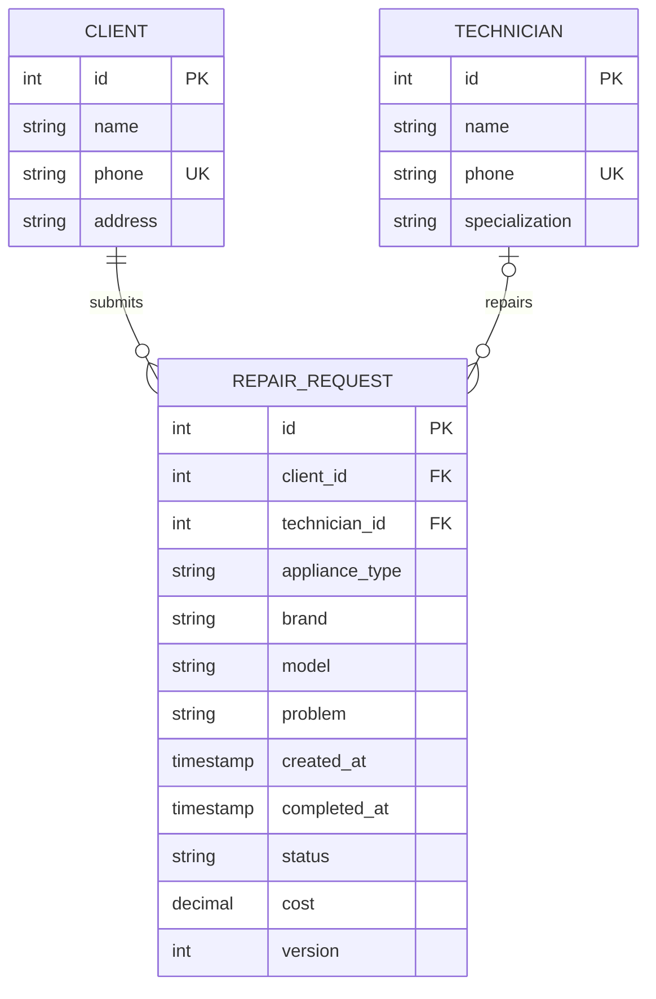

# Предметная модель

**Предметная область:** сервис ремонта бытовой техники.
**Основная сущность:** заявка на ремонт бытовой техники (`RepairRequest`).

| Сущность | Основные атрибуты | Назначение |
| --- | --- | --- |
| Клиент | ID, ФИО, телефон, адрес | Владелец техники и контакт для выдачи |
| Мастер | ID, ФИО, телефон, специализация | Исполнитель диагностики и ремонта |
| Заявка | ID, клиент, мастер, вид техники, бренд, модель, неисправность, даты, статус, стоимость, версия | Учёт конкретного обращения |

У клиента может быть много заявок, каждая заявка принадлежит одному клиенту.
У мастера может быть много заявок, у заявки — не более одного текущего мастера.
Мастер необязателен при регистрации; перед диагностикой его необходимо назначить.
Данные о технике хранятся в самой заявке как сведения на момент обращения.

## Соответствие проекту-примеру

| Meetly | Repairly |
| --- | --- |
| Пользователь | Клиент |
| Переговорная | Мастер |
| Бронирование | Заявка на ремонт |
| Проверка пересечения времени | Проверка этапов ремонта и назначенного мастера |
| Статистика бронирований | Статусы и стоимость завершённых ремонтов |
| Три листа Excel | Клиенты, мастера, заявки |

Репозитории отвечают за JDBC; сервисы — за правила; UI — за ввод и вывод.
Сервисы получают зависимости через конструкторы, поэтому один набор тестов может
проверять H2 и PostgreSQL. Внешние ключи используют `RESTRICT`, чтобы удаление справочника
не приводило к потере истории ремонта. Критичные ограничения продублированы в SQL.

Приложение учебное: нет авторизации, склада запчастей, расписания мастеров, платежей,
аудита переходов или автоматического назначения по специализации. Сумма отражает
стоимость работ. Изменения справочников видны при просмотре связанных заявок.
