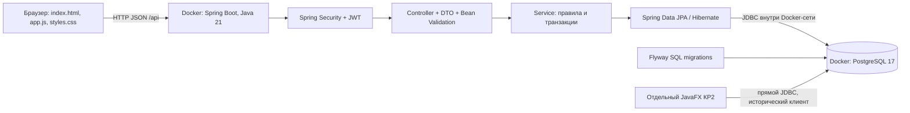

# КР3: архитектура Repairly и сценарий защиты

## Что где выполняется



Корневой `docker-compose.yml` запускает два сервиса: `postgres` и `backend`.
`backend/Dockerfile` сначала собирает Maven JAR на JDK 21, затем запускает его на JRE 21
от непривилегированного пользователя. HTML/CSS/JS входят в этот JAR как static resources.
JavaScript исполняет браузер. Отдельного контейнера frontend и Node.js для запуска нет.

В КР3 FXML не используется: страницы строит `backend/src/main/resources/static/app.js`,
основа документа — `index.html`, оформление — `styles.css`. FXML остаётся в старом JavaFX
проекте под корневым `src/`; этот проект не участвует в HTTP-запросах web.

## Запуск и проверка Docker

Из корня: `./run.sh` (macOS/Linux) или `powershell -ExecutionPolicy Bypass -File .\run.ps1`.
Скрипт дополняет `.env`, затем запускает `docker compose up -d --build --wait`.

```bash
docker compose ps
curl http://localhost:8080/actuator/health
docker compose logs --tail=100 backend
```

Оба контейнера должны быть healthy. PostgreSQL проверяется через `pg_isready`, backend —
через HTTP health endpoint Actuator. Healthy подтверждает готовность сервиса; функциональные
тесты отдельно проверяют правила и операции API. `docker compose down` сохраняет volume,
а `down -v` удаляет его вместе с данными, поэтому для обычной остановки `-v` не нужен.

## Путь одной операции

При нажатии «Сохранить» в форме заявки:

1. `repairForm()` собирает DTO, `send()`/`api()` отправляют JSON и Bearer access JWT.
2. `CorrelationIdFilter` задаёт код запроса. `JwtAuthenticationFilter` проверяет подпись,
   issuer, срок JWT, активность пользователя и `securityVersion`, загружает текущие роли.
3. `PasswordChangeRequiredFilter` ограничивает временный пароль. `@PreAuthorize` в
   `RepairController` проверяет EDITOR/ADMIN, `@Valid` проверяет DTO.
4. `RepairService.update()` в транзакции проверяет `version`, статус, клиента, мастера,
   уникальность номера, теги. `PriorityCalculator` определяет приоритет.
5. JPA сохраняет изменение в PostgreSQL. `flush()` выполняет SQL до формирования ответа,
   поэтому DTO содержит новую версию. `AuditService` записывает событие в той же транзакции.
6. `RepairMapper` создаёт DTO без Hibernate-сущностей. Браузер закрывает форму и заново
   запрашивает список с текущим фильтром. При ошибке форма остаётся открытой с сообщением.

## Ответственность классов

Все Java-классы backend находятся под `backend/src/main/java/ru/rtumirea/repairly/backend/`.

| Место | Что объяснить |
|---|---|
| `RepairlyBackendApplication` | Точка входа Spring Boot, создание контекста и запуск HTTP-сервера |
| `controller/` | URL, HTTP-методы, роли, валидация DTO, вызов сервиса |
| `dto/` | Отдельные контракты запроса/ответа; нельзя сериализовать JPA-сущности напрямую |
| `service/RepairService` | Бизнес-правила, операции с заявкой и границы транзакций |
| `service/ClientService`, `TechnicianService` | Изменение справочников, отключение, уникальность и версии |
| `repository/` | Spring Data JPA; запросы, подсчёты, поиск, связи с PostgreSQL |
| `domain/` | JPA-сущности, enum, связи, `@Version`, даты и UUID |
| `filter/` | Разбор фильтра и безопасная JPA Specification |
| `security/`, `config/SecurityConfig` | JWT, BCrypt, роли, запрет временного пароля, обработка 401/403 |
| `service/AuthService`, `LoginAttemptService` | Вход, refresh, выход, смена пароля, блокировка попыток |
| `service/CsvRepairService` | CSV, предварительная проверка и применение по строкам |
| `service/AnalyticsService` | Сводка через агрегатные запросы |
| `service/AuditService` | Аудит в PostgreSQL, автор и correlation ID |
| `error/GlobalExceptionHandler` | Единый безопасный JSON ошибок |
| `web/PageableFactory` | Разрешённые сортировки, ограничение размера страницы |

## Сохранение базы КР1 и Flyway

`V1__kr1_schema.sql` создаёт исходные `clients`, `technicians`, `repair_requests`, если их
ещё нет. `V2__kr3_backend.sql` расширяет эти таблицы и добавляет пользователей, роли,
refresh-сессии, теги, заметки и аудит. Миграции лежат в `backend/src/main/resources/db/migration`.

Старые числовые PK/FK сохранены. REST использует добавленный UUID `public_id`; JPA-связи
клиента и мастера продолжают ссылаться на прежний числовой `id`. Это позволяет сохранить
старые записи и JDBC-клиент. Для старых записей сформированы коды `R-<id>`, `C-<id>`, `T-<id>`.
JavaFX напрямую обращается к БД и не проходит проверки ролей/аудит API — это отдельный
клиент КР2, а не способ администрирования КР3.

Flyway ведёт `flyway_schema_history`: версия, контрольная сумма, результат. Применённые
миграции не редактируют; следующее изменение схемы оформляют новым V3, V4 и т. д.
Для известной базы КР1 применяется baseline 0. На произвольную чужую схему этот механизм
не рассчитан. Hibernate использует `ddl-auto: validate`, а не автоматическое изменение БД.

## Авторизация и роли

VIEWER читает, EDITOR изменяет заявки и заметки, ADMIN дополнительно управляет
справочниками, пользователями и аудитом. Скрытие кнопки — удобство интерфейса;
реальная проверка прав всегда на сервере.

Пароль проверяется BCrypt, открытый пароль не сохраняется в таблице и не возвращается
из API. Временный пароль требует замены. Политика: минимум 12 символов, разные классы
символов, максимум 72 байта UTF-8 из-за ограничения BCrypt. После пяти ошибок вход
временно блокируется; неудачные попытки сохраняются независимо от отката login-транзакции.

Access JWT короткоживущий и подписанный: подпись защищает от изменения, но не шифрует
payload. Refresh — случайная строка; в БД хранится SHA-256-хеш. При обновлении refresh
заменяется, прежний отзывается. Повторное использование заменённого токена отзывает
refresh-сессии пользователя. Строка сессии блокируется на время ротации.

Web хранит access только в памяти, refresh — HttpOnly SameSite=Strict cookie. На localhost
используется HTTP (`COOKIE_SECURE=false`); при HTTPS выставляется true. Для Android
`clientType=NATIVE` получает refresh в JSON. Logout отзывает refresh, но уже выданный
access действует до истечения срока; смена/сброс пароля меняет `securityVersion` и
немедленно делает прежние access JWT недействительными. Отключённый пользователь также
теряет доступ при следующем запросе.

## Версии, архив и бизнес-правила

`@Version` предотвращает потерю изменений: два пользователя открыли version 3,
первый сохранил и получил version 4, второй с version 3 получит HTTP 409. Ему нужно
обновить карточку. Проверяется версия из DTO и реальный конкурентный UPDATE Hibernate.

Обычный DELETE ставит `archived=true`. Восстановление снимает этот флаг. Физически
удалить можно только архивную запись, ролью ADMIN, при включённой настройке и с
`X-Confirm-Delete: PERMANENTLY_DELETE`; заметки и теги удаляются внешними ключами CASCADE.

Новая заявка всегда NEW. Переходы задаёт `RepairStatus.canTransitionTo()`. Для рабочего
статуса нужен мастер, нельзя менять клиента зарегистрированной заявки или редактировать
закрытую/архивную заявку. Клиенты и мастера выбираются из справочника, отключённые записи
нельзя назначить заново. Стоимость — `BigDecimal`, а не `double`.

Приоритет: закрытая — NOT_APPLICABLE; срочная в WAITING_PARTS — CRITICAL; срочная — HIGH;
WAITING_PARTS или стоимость от 10000 — MEDIUM; остальные — LOW. PostgreSQL-триггер
поддерживает это значение и для прямых изменений историческим JDBC-клиентом.

## Поиск, пагинация и сортировка

`SmartFilterParser` преобразует `q` в `RepairFilter`; `RepairSpecifications` собирает
Criteria API. Пользовательская строка не становится SQL. Текст ищется по номеру,
технике, неисправности, клиенту/телефону и коду мастера; `%` и `_` экранируются.
Фильтры: точный код мастера, статус, срочность, приоритет, тег, архив и сравнения стоимости.

`PageableFactory` разрешает только известные поля сортировки, страницу от 0 и размер
1–100. В конце добавляется UUID для стабильного порядка при одинаковых значениях.
PostgreSQL выполняет ограничение/смещение, клиент не загружает весь список для пагинации.
Тег проверяется через EXISTS: соединение с набором тегов не размножает строки заявок.

## Заметки и массовые действия

`NoteService` хранит автора, время, закрепление и версию. Редактировать/удалять может
автор или ADMIN. UUID заметки проверяется вместе с принадлежностью указанной заявке.

В `RepairService.bulk()` каждый UUID обрабатывается отдельной транзакцией REQUIRES_NEW.
Ошибка одной строки не откатывает остальные. Ответ содержит requested, succeeded и
список failures с UUID и сообщением. Статусы и теги проходят те же бизнес-правила.

## CSV и аналитика

Preview разбирает CSV, проверяет заголовок, типы, обязательные поля, справочники,
дубликаты, ограничения и возвращает число правильных/ошибочных строк. Ничего не пишет.
Apply заново читает и проверяет файл, затем сохраняет каждую подходящую строку отдельной
операцией. Preview не резервирует данные: между запросами база могла измениться.

CREATE_ONLY запрещает повторный номер; UPSERT_BY_EXTERNAL_ID обновляет существующую
заявку по номеру с проверкой версии. Закрытые заявки также нельзя переписывать импортом.
Ограничения — 5 MB и 5000 строк. CSV в UTF-8, BOM допускается. При экспорте используются
текущие фильтры и все соответствующие строки, независимо от открытой страницы; потенциальные
формулы нейтрализуются апострофом. В CSV выбираются коды справочников, не внутренние ID.

`AnalyticsService` получает из БД total, active (неархивные), archived, urgent (среди активных),
среднюю стоимость активных и группировки активных по мастеру, статусу, приоритету.
Это серверные COUNT/AVG/GROUP BY, а не расчёт по текущей странице браузера.

## Ошибки, аудит и Swagger

Bean Validation проверяет DTO, Service — правила/связи, PostgreSQL — ограничения и FK.
`GlobalExceptionHandler` возвращает `ApiError`: status, code, message, path,
correlationId, validationErrors, timestamp. Коды: 400 — данные, 401 — авторизация,
403 — права, 404 — запись, 409 — версия/уникальность. Stack trace и SQL видны только в
серверном журнале. В интерфейсе ошибка показана рядом с формой или уведомлением.

Audit хранится отдельно от технических логов: actor, событие, сущность/UUID, время,
краткое описание, correlation ID. HTTP-заголовок `X-Correlation-ID` помогает связать
ответ с событием и серверным запросом. Поиск и пагинация аудита доступны только ADMIN.

Swagger доступен ADMIN после web-входа: вспомогательная HttpOnly cookie открывает
Swagger и OpenAPI, но не авторизует обычный API. Для «Try it out» выполните login с
clientType NATIVE и вставьте полученный accessToken в Authorize. Смена временного пароля
должна быть уже завершена. JWT не сохраняется Swagger между перезагрузками.

## План демонстрации

1. Запустить Docker, показать два healthy-сервиса и `/actuator/health`.
2. Войти ADMIN, при первом входе заменить временный пароль.
3. Создать VIEWER и EDITOR, показать различие кнопок и серверный 403 для запрещённого запроса.
4. Создать клиента/мастера, затем заявку; изменить стоимость, срочность и разрешённый статус.
5. Ввести отрицательную стоимость/повторный номер, показать понятную ошибку.
6. Открыть одну заявку в двух вкладках, сохранить в обеих и объяснить 409.
7. Показать поиск, два фильтра одновременно, сортировку и размер страницы.
8. Архивировать и восстановить. Выбрать несколько заявок и добавить тег массово.
9. Создать, закрепить и изменить заметку; показать автора и дату.
10. Экспортировать фильтр, изменить номер и статус на NEW в одной строке, выполнить preview
    и apply. Во второй строке поставить отрицательную стоимость и показать счётчики ошибок.
11. Открыть аналитику, пользователей, аудит, Swagger.
12. Показать две миграции, `flyway_schema_history`, исходные ID и новые UUID.

Для лайвкодинга удобно заранее найти: `PriorityCalculator` (правило), `RepairDtos`
(поле/валидация), `SmartFilterParser` и `RepairSpecifications` (новый фильтр),
`RepairMapper` (ответ), `app.js/repairForm` (форма). Новое поле БД требует новой миграции,
изменения Entity/DTO/Mapper/Service и интерфейса, а также проверки сценария.
